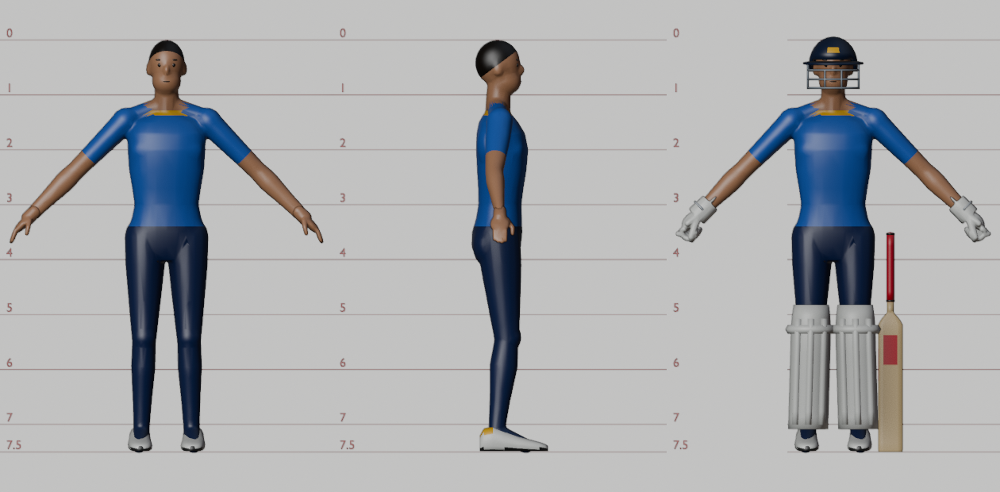

# Squad body proportions

Every player, umpire and fielder is built from one body canon in
[`tools/blender/proportions.py`](../tools/blender/proportions.py). The skeleton, body
mesh, outfits and the bat grip all read their numbers from there. Change the canon and
rebuild, and everything follows.



## The canon

A stylised athlete, **7.5 heads tall (1.80 m, 1 head = 0.24 m)**. Faces stay simple (eyes,
brows, a mouth line). The proportions follow a real adult, so poses read correctly from
any camera.

| Landmark | Height | Heads from the top |
|---|---|---|
| Chin | 1.56 m | 1 |
| Nipple line | 1.32 m | 2 |
| Navel / waist | 1.08 m | 3 |
| Crotch | 0.84 m | 4 |
| Fingertips (arms down) | 0.67 m | mid-thigh |
| Knee | 0.50 m | 5.4 |

| Width | Size | Rule |
|---|---|---|
| Shoulders (deltoids) | 0.47 m | just under 2 heads |
| Hips | 0.35 m | about 1.45 heads, narrower than the shoulders |
| Waist | 0.28 m | narrowest point of the torso |

| Segment | Length |
|---|---|
| Upper arm | 0.32 m |
| Forearm | 0.265 m |
| Hand (wrist to fingertip) | 0.19 m |
| Thigh | 0.43 m |
| Shin | 0.415 m |
| Foot | 0.265 m |

Limb girths taper from top to bottom, with bulges at the bicep, forearm and calf. They
are listed as profiles in `proportions.py`.

## Holding the bat

- The handle crosses the palm **diagonally**, from the heel of the hand to the base of the
  index finger (`GRIP_ANGLE` = 32°). So the forearm meets the bat at about 120°, not 90°.
- Both thumbs point down the handle, towards the blade. The hands sit together, 9.2 cm
  apart (`HAND_GAP`).
- For every frame the rig turns each fist around the handle, and lets the elbow swivel
  up to 45° off its pole. It keeps the combination that bends the wrist least.
- The hands stay between 0.34 m (elbow bent to about 65°) and full reach from the
  shoulder, so the arms never crumple or overstretch.

## Bat

A standard men's bat: 965 mm long, blade 108 mm wide. The blade has a slightly bowed
face, 40 mm edges and a spine that rises to 64 mm at the sweet spot, then curves at the
shoulders into the handle. The rubber grip is about 34 mm across. The sweet spot is
0.77 m below the top-hand grip (the game uses this in `game/squad-nets.js`).

## Rebuilding

```
blender --background --factory-startup --python tools/blender/proportions_sheet.py   # this sheet
blender --background --factory-startup --python tools/blender/build_all.py           # whole squad
blender --background E:/blender/cricketer.blend --python tools/blender/probe.py -- cover_drive 0,27,42
```

`probe.py` prints elbow and wrist angles per frame. Keep wrists under about 60° outside
the fastest swing frames.
